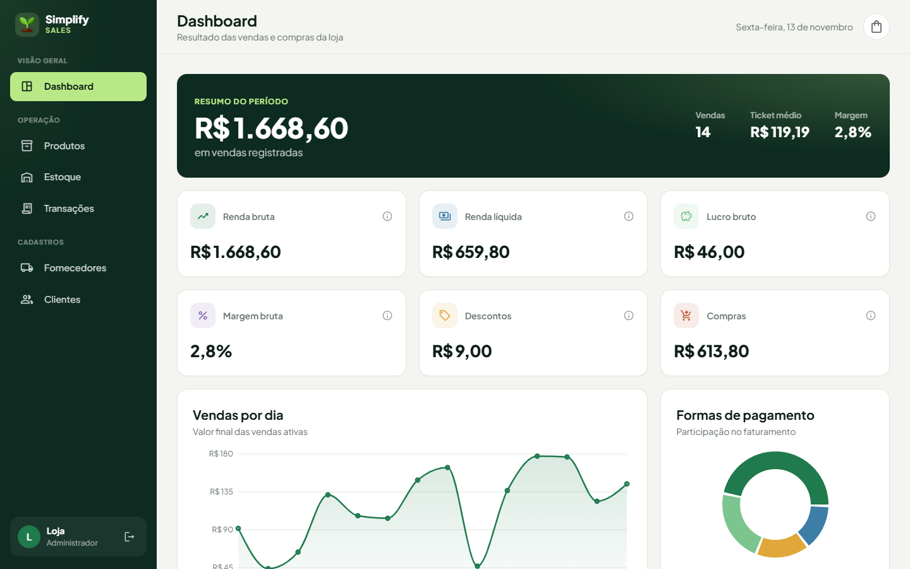
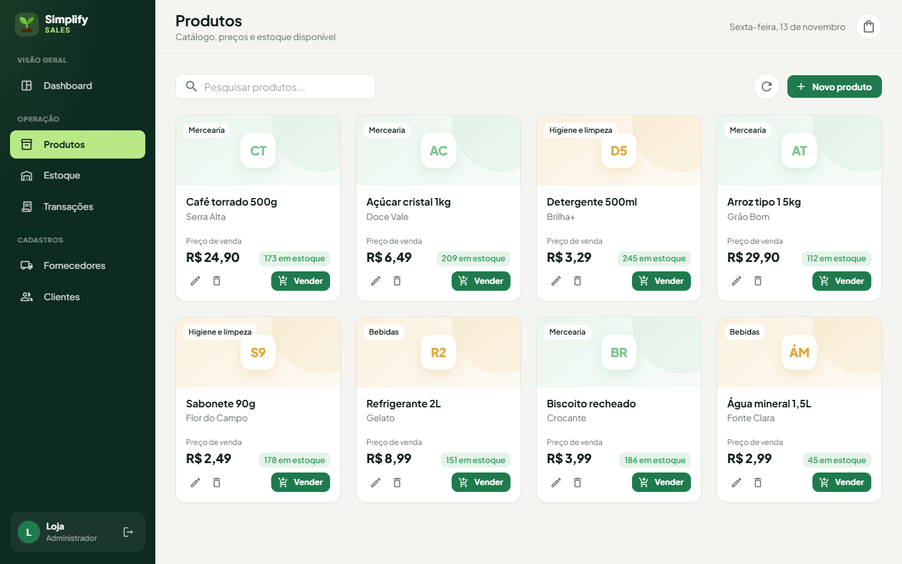
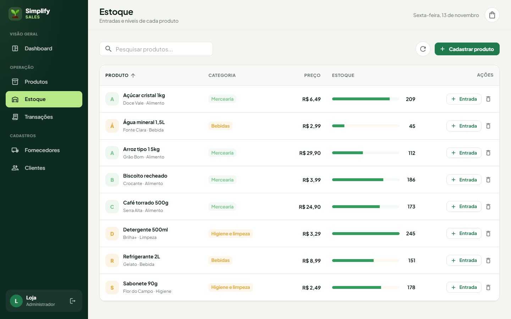
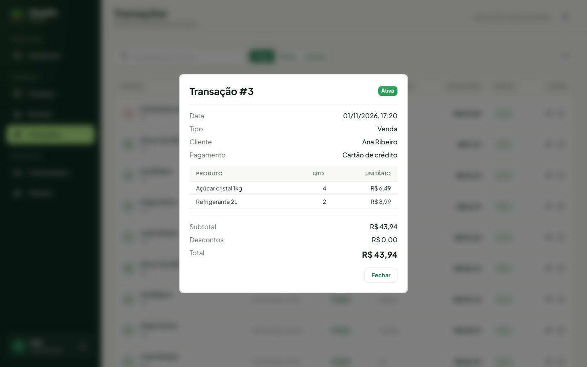

# Simplify Sales Management

A web system for a micro-enterprise with three employees to manage sales and purchases. It centralizes product, supplier and client registration, stock control, transactions and user login in a single application.



| Products | Stock |
| :-: | :-: |
|  |  |
| **Transaction details** | **Login** |
|  |  |

*Screenshots use fictional demo data.*

## Tech stack

**Back-end:** ASP.NET Core (.NET 8), Entity Framework Core 9, SQLite or SQL Server, Swagger.

**Front-end:** React 18, TypeScript, Vite, Material UI, Redux.

## Features

**Registration:** products, suppliers and clients.

**Stock:** sales take items out of stock, purchases from suppliers add them back, with low-stock and out-of-stock states in the UI.

**Transactions:** sales and purchases with per-item and total discounts, payment method and a detail view.

**Access:** user registration and login, with salted PBKDF2 password hashing.

**Dashboard:** gross and net revenue, discounts, purchases, gross profit and margin, formatted in BRL.

## Project structure

`Backend/` holds the ASP.NET Core Web API. `Frontend/` holds the React + TypeScript app.

## Getting started

**Requirements:** .NET 8 SDK and Node 18+. SQL Server is optional.

**1. Run the API.** By default it uses a local SQLite file, so nothing else needs to be installed. The schema is created on the first run.

```bash
cd Backend
dotnet run --launch-profile https
```

Swagger is served at the root path and the API listens on https://localhost:7159.

**2. Run the front-end.**

```bash
cd Frontend
npm install
npm run dev
```

The front-end reads the API address from `VITE_API_URL`. Copy `Frontend/.env.example` to `Frontend/.env` if your API runs somewhere else.

### Using SQL Server instead

Copy `Backend/appsettings.Example.json` to `Backend/appsettings.Development.json` (git-ignored), set your connection string, then apply the migrations:

```bash
cd Backend
dotnet ef database update
dotnet run --launch-profile https
```

## Known limitations and roadmap

**Authentication:** the login token is a placeholder and API routes are not protected. Planned: JWT-based authentication.

**CORS:** currently open to all origins. Planned: restrict to the front-end origin.

**Tests:** there are none yet. Planned: unit tests for the services and the transaction flow.

**Done:** passwords moved from unsalted SHA-256 to salted PBKDF2 (old accounts are upgraded on their next login); the API URL moved to an environment variable; the project can run on SQLite without SQL Server.
